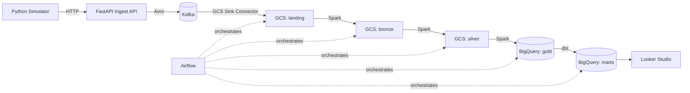

# Crowdsource Data App — GCP Clone

A project that clones crowodsourced data application's production data engineering architecture on GCP: a full pipeline from simulated device measurements through to a BI dashboard, built with the same technologies a real network-experience data platform would use — Kafka, Spark, Airflow, dbt, Looker Studio, Terraform, GitHub Actions, and Prometheus/Grafana.

## Pipeline Overview



A simulator generates fake mobile network measurements (100 devices, 4 UK operators: EE, Three, O2, Vodafone), sends them to a FastAPI ingest service, which validates and publishes them to Kafka. A GCS Sink Connector lands raw Avro files in a "landing" bucket. Airflow orchestrates an hourly Spark pipeline through a medallion architecture (bronze → silver → gold), landing the final aggregates in BigQuery. dbt builds derived marts on top of the gold table, which feed a Looker Studio dashboard. The whole thing is monitored via Prometheus/Grafana/Alertmanager with Slack alerting, and application images are built via GitHub Actions CI/CD.

---

## Key Reference

| Item | Value |
|---|---|
| GCP Project | `crowdsource-data-app-clone` |
| Region | `europe-west2` |
| GKE Cluster | `crowdsource-data-app-gke` (Autopilot, private nodes) |
| Kafka Cluster | `crowdsource-data-app-kafka` (KRaft mode, 3 dual-role brokers) |
| Static IP | `34.89.87.57` (ingest API LoadBalancer) |
| Terraform State Bucket | `crowdsource-app-tfstate-crowdsource-data-app-clone` |
| GitHub Repo | `https://github.com/bassemessam1/crowdsource-data-app-clone` |
| Artifact Registry | `europe-west2-docker.pkg.dev/crowdsource-data-app-clone/crowdsource-data-app/` |

**Connect kubectl:**
```bash
gcloud container clusters get-credentials crowdsource-data-app-gke \
  --region europe-west2 --project crowdsource-data-app-clone
```

---

## Session Lifecycle

This project is **ephemeral by design** — the GKE cluster, Kafka, Airflow, and monitoring stack are all torn down and recreated each session to control cost. Two long-lived exceptions: the GCS data lake buckets and BigQuery datasets, and Terraform's `foundations` module (service accounts, IAM), persist across sessions.

**Start a session:**
```bash
./scripts/startup-cluster.sh
```
This single script recreates the entire cluster: GKE, cert-manager, External Secrets, Strimzi (Kafka), Prometheus/Grafana/Alertmanager, Kafka Connect (with its JMX exporter), the Ingest API, the Simulator, Spark Operator, Airflow (with StatsD metrics), and all the Phase 08 monitoring manifests (PodMonitors, ServiceMonitor, PrometheusRule, Grafana dashboard).

**One manual step every session** (by design — not automated, since it's a judgment call on secret-handling, see Phase 08 below):
```bash
kubectl create secret generic alertmanager-slack-webhook \
  --namespace monitoring \
  --from-literal=url='<slack-webhook-url>'
```
Without this, Alertmanager starts fine but has nothing to read for its Slack receiver.

**End a session:**
```bash
./scripts/teardown-cluster.sh
```

---

## Phase-by-Phase

### Phase 00 — Foundation
VPC (`crowdsource-aap-vpc`), Cloud Router + NAT (needed for private-node image pulls), Workload Identity Federation pool for GitHub Actions, and the `sa-terraform` service account. Lives in `terraform/foundations/` — applied once, not part of the session lifecycle.

### Phase 01 — GKE Platform
GKE Autopilot cluster, Workload Identity bindings for every service account (`ksa-ingest-api`, `ksa-spark`, `ksa-airflow`, `ksa-dbt`), and the monitoring stack (Prometheus + Grafana + Alertmanager via `kube-prometheus-stack`) with all default kube-system-touching components disabled (required for Autopilot compatibility).

### Phase 02 — Kafka + Ingest
Strimzi-managed Kafka (KRaft mode — no ZooKeeper), a Schema Registry, a hand-built Kafka Connect image (`kafka-connect-gcs`, based on `confluentinc/cp-kafka-connect:7.6.0` with the GCS sink plugin baked in via `confluent-hub install`), the FastAPI ingest service, and the measurement simulator.

**Known quirk:** the GCS Sink Connector's `path.format` uses Joda-Time syntax, which requires literal text to be single-quoted (`'year'=YYYY`, not `year=YYYY`) or it throws a cryptic `Illegal pattern component` error at the task level (not the connector level — the connector itself will show `RUNNING` even when its task is `FAILED`).

### Phase 03 — Data Lake
GCS buckets for each medallion layer (`landing`, `bronze`, `silver`, `gold`), Spark Operator, and three Spark jobs (`bronze_job.py`, `silver_job.py`, `gold_job.py`) that progressively clean, dedupe/enrich, and aggregate the data, landing the final result in BigQuery (`crowdsource_data_app_gold.operator_metrics`).

**Known quirk:** all three Spark jobs do a full `mode("overwrite")` of their entire input on every run — there's no incremental processing. This means freshness has to be checked by looking at the actual date values in the output, not just "did the job succeed."

### Phase 04 — Airflow
Airflow 2.9.2 (`KubernetesExecutor`), with Cloud SQL Postgres as the metadata DB (not the chart's built-in Postgres), DAGs synced live from this repo via GitSync. `daily_batch_pipeline` runs hourly: `delete_old_jobs -> bronze_job -> silver_job -> gold_job -> dbt_transform`.

**Hard-won lessons from this phase** (the ones worth remembering):
- `KubernetesExecutor` worker pods run as a different service account (`ksa-airflow`) than the scheduler — RBAC bound only to `airflow-scheduler` silently fails every real task while `tasks test` (which runs in-process) works fine.
- `kubectl run --rm` for one-shot registration pods is unreliable — it doesn't reliably wait for the command to finish before tearing the pod down. Port-forward + direct `curl` is the dependable method.
- A cancelled Terraform CI run can leave an orphaned GCS state lock (`terraform force-unlock` fixes it).

### Phase 05 — dbt
A dbt project (`dbt/`) transforms `operator_metrics` into clean marts: `stg_operator_metrics` (staging view, reconstructs real dates from unpadded `year`/`month`/`day`/`hour` columns), `daily_operator_summary`, `operator_rankings`, and `bi_operator_daily` (a combined view built specifically for Looker Studio). Containerized and run as a `KubernetesPodOperator` task in the Airflow DAG.

**Important:** the dbt image is **not** kept in sync by GitSync — unlike the DAG files, model changes require rebuilding and re-pushing the Docker image (`docker build`/`docker push`) before they take effect in the cluster.

### Phase 06 — Looker Studio
A dashboard connected directly to `bi_operator_daily` via the native BigQuery connector — no credentials file needed, it uses the viewer's own Google account access. Trend charts for download/upload speed and latency, broken down by operator, with date-range and operator filter controls.

### Phase 07 — CI/CD (GitHub Actions)
Three workflows in `.github/workflows/`, authenticated via the WIF pool from Phase 00 (no service-account keys stored as secrets):
- **`docker-build.yml`** — rebuilds whichever of `ingest-api`/`simulator`/`spark`/`dbt` changed, tagged with both `:latest` and the commit SHA.
- **`terraform-plan.yml`** — runs `fmt`/`validate`/`plan` per Terraform module on push, read-only.
- **`terraform-apply.yml`** — manual (`workflow_dispatch`) only; applying real infrastructure changes is a deliberate human action, never automatic.

### Phase 08 — Monitoring & Alerting
- **Metrics:** a `PodMonitor` for Kafka brokers (JMX exporter, already configured by Strimzi), a hand-added JMX exporter for Kafka Connect (connector/task status, real consumer lag — Connect runs as a plain Deployment, so this needed a custom Dockerfile layer, not a Strimzi CRD feature), and Airflow's StatsD exporter with custom `extraMappings` to turn dag/task-ID-baked metric names into proper Prometheus labels.
- **Alerting:** three `PrometheusRule`s — Kafka Connect task failure, sustained consumer lag, and Airflow task failure — routed to Slack via Alertmanager, scoped specifically to a `project: data-pipeline` label so the chart's own generic cluster-health alerts (`KubeMemoryOvercommit`, etc.) don't flood the channel.
- **Dashboard:** a "Pipeline Health" Grafana dashboard (delivered as a labelled ConfigMap the chart's sidecar auto-discovers), covering Airflow task outcomes, Kafka Connect task status, consumer lag, executor load, and broker request rate.

**Deliberately out of scope:** SparkApplication failure alerting — Spark Operator was never installed with metrics enabled, so there's no Prometheus signal for Spark job failures specifically (Airflow task failure still catches this indirectly, since a failed Spark job fails its Airflow task).

**The one real root-cause story worth retelling:** Airflow's actual raw StatsD metric is `airflow.ti.finish.<dag_id>.<task_id>.<state>` — note the **dot** between `ti` and `finish`. Every mapping rule written with an underscore (`ti_finish`) silently failed to match, for multiple sessions, because the fallback/unmapped metric name (which *does* use underscores, since it blindly converts every dot) made the two forms indistinguishable by eye. The fix was found only by enabling `--log.level=debug` on the StatsD exporter and reading the literal raw line.

---

## Repo Structure

```
crowdsource-data-app-clone/
├── airflow/dags/                    # Synced live into Airflow via GitSync
├── dbt/                             # dbt project -- containerized separately
├── ingest-api/                      # FastAPI service
├── simulator/                       # Measurement simulator
├── spark/jobs/                      # bronze/silver/gold PySpark jobs
├── kubernetes/
│   ├── kafka/                       # Strimzi Kafka cluster + topics + PodMonitor
│   ├── kafka-connect/               # Custom Connect image, Dockerfile, metrics config
│   ├── schema-registry/
│   ├── ingest-api/
│   ├── simulator/
│   ├── spark/                       # SparkApplication manifests
│   ├── airflow/                     # Helm values, RBAC, StatsD ServiceMonitor
│   └── monitoring/                  # Prometheus/Alertmanager values, alert rules, dashboard
├── terraform/
│   ├── foundations/                 # Long-lived: IAM, service accounts, WIF
│   ├── gke/                         # Ephemeral: cluster, Workload Identity bindings
│   ├── lake/                        # Long-lived: GCS buckets, BigQuery datasets
│   └── cloudsql/                    # Long-lived: Airflow's Postgres
├── .github/workflows/               # CI/CD (Phase 07)
└── scripts/
    ├── startup-cluster.sh
    └── teardown-cluster.sh
```

---

## Access

| What | How |
|---|---|
| Airflow UI | `kubectl port-forward svc/airflow-webserver 8080:8080 -n airflow` -> `admin` / `crowdsource-dev-2026` |
| Grafana | `kubectl port-forward svc/kube-prometheus-grafana 3000:80 -n monitoring` -> `admin` / `crowdsource-dev-2026` |
| Prometheus | `kubectl port-forward svc/kube-prometheus-kube-prome-prometheus 9090:9090 -n monitoring` |
| Ingest API | `curl http://34.89.87.57/health` |
| BigQuery (gold) | `bq query --use_legacy_sql=false 'SELECT * FROM crowdsource_data_app_gold.operator_metrics LIMIT 10'` |
| BigQuery (marts) | `bq query --use_legacy_sql=false 'SELECT * FROM crowdsource_data_app_marts.bi_operator_daily LIMIT 10'` |
| Looker Studio dashboard | `https://datastudio.google.com/reporting/4e9ace7b-6d25-49e9-a7ad-87196f255a24` |

---

## Known Gaps

- No SparkApplication-level alerting (Spark Operator metrics not enabled)
- `terraform-apply.yml` and `docker-build.yml`'s `spark` image path are written but not yet exercised end-to-end in CI
